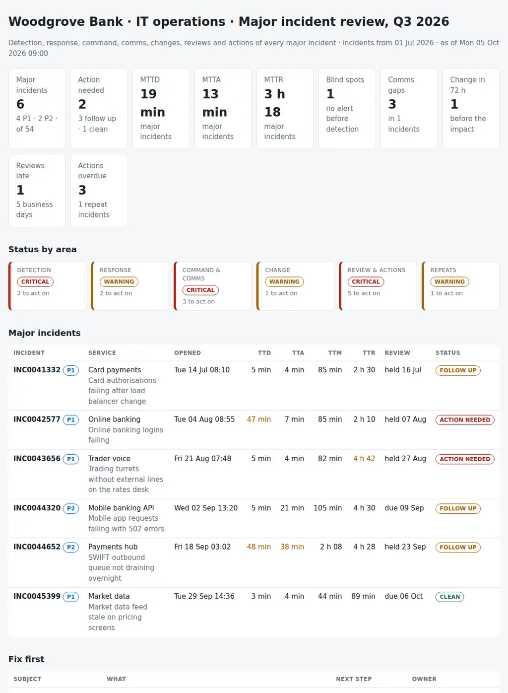

# Major Incident Command Kit

Running and reviewing the major incidents (P1 and P2) of an IT operations team. For every major incident of the period it puts together:

- **Detection:** the first alert, the first user report, when IT knew and when the ticket was opened, and whether monitoring saw it at all.
- **Response:** time to acknowledge, mitigate and resolve against the targets of its priority, and who ran it: incident commander, comms lead, tech lead.
- **Communications:** an update to stakeholders every N minutes as the policy says, the gaps, and the resolution notice.
- **What came before and after:** changes on the service in the 72 hours before, the post-incident review within N business days, the root cause, the actions and their due dates, and the incidents that came back on the same service or CI.

Seven exports, one JSON with the rules and one Python command give each major incident a verdict (**clean**, **follow up** or **action needed**), a timeline, and a draft post-incident review with the parts only people can write clearly marked. A `start` command prints the role card, the first-fifteen-minutes checklist and the first stakeholder update for the next one.

Python 3.10+, standard library only. It runs with fictional demo data out of the box. A read-only PowerShell exporter for ServiceNow (Table API) and Jira Service Management (REST search) is included.



## Why

The post-incident review is usually written a week later, from memory, by the person who was busiest on the bridge. By then the timeline is a guess, and the questions that would change something next time are not asked:

- the service desk had 34 calls about logins before anyone in IT knew, and no alert fired until 39 minutes after detection;
- an alert on the payments queue fired at 02:10 and the operator saw it at 02:58;
- the trading desk went 95 minutes without an update, and nobody sent the resolution notice;
- the load balancer change the night before was the cause, and the ticket does not say so;
- the action that would have caught the login outage is 35 days overdue;
- the mobile API outage was the third incident on the same gateway in ten days.

The facts are in the ITSM tool, the monitoring consoles, the bridge chat and the sent folder. The review that matters joins them per incident, measured against the policy the team signed up to. The rules are in `settings.json` and `mickit/checks.py`.

## What it checks

| Area | Code | Finding |
|---|---|---|
| Detection | DET-01 | Monitoring blind spot: no alert on the service or CI before detection (users or the desk told us first); critical for P1 |
| Detection | DET-02 | Detected more than `detect_gap_min` after the first signal (impact start, first alert or first user report) |
| Detection | DET-03 | Ticket opened more than `open_lag_min` after detection |
| Response | RSP-01 | Acknowledged over the target for its priority |
| Response | RSP-02 | Mitigated over target; critical for a P1 over twice the target |
| Response | RSP-03 | Resolved over target |
| Response | RSP-04, MET-01 | Major incidents still open, and MTTA / MTTR by priority for the period (for information) |
| Command & comms | CMD-01 | Incident commander, comms lead or tech lead not recorded; critical when a P1 has no commander |
| Command & comms | COM-01 | First update late, gaps between updates over `comms_interval_min`, no update before resolution, no resolution notice; critical for P1 gaps over twice the policy |
| Change | CHG-01 | A change on the service or CI in the `change_lookback_hours` before the impact, linked or not in the ticket |
| Review & actions | PIR-01 | No post-incident review within `pir_business_days` business days, or held late; due soon (for information) |
| Review & actions | PIR-02 | No problem record, or no root cause recorded, once the review is due |
| Review & actions | ACT-01 | Post-incident actions past their due date; critical after `action_critical_days` |
| Review & actions | ACT-02 | No post-incident action recorded |
| Repeats | REP-01 | Other incidents on the same CI (or service) within `repeat_days` before or after |

## Outputs

| File | What |
|---|---|
| `report.html` | Tiles, status by area, the major incidents with TTD/TTA/TTM/TTR and verdict, "Fix first", a timeline per incident (inline SVG: impact, alerts, user reports, ticket milestones, bridge, updates and the gaps between them), metrics by month, overdue actions, all findings |
| `reviews/PIR-<number>.md` | A draft post-incident review per major incident: summary, impact, metrics against target, timeline, detection, changes, root cause, actions, repeats, and **[TO COMPLETE IN THE REVIEW]** where people have to write |
| `major-incidents.csv` | Every major incident with its times, durations, roles, updates, changes, problem, review and actions |
| `metrics.csv` | MTTD, MTTA, MTTM and MTTR by month and priority over all incidents, with the share inside the targets |
| `comms-gaps.csv` | Every stretch without a stakeholder update longer than the policy |
| `actions-overdue.csv` | Open post-incident actions past their due date, with owner and days late |
| `repeats.csv` | The incidents on the same CI or service around each major incident |
| `actions.csv`, `findings.csv` | The findings with owner and next step, ready for a tracker |

## Try it

```bash
git clone https://github.com/inigogonzalezgarcia/36-major-incident-command-kit.git
cd 36-major-incident-command-kit
python -m mickit demo
```

Open `output/report.html` and the drafts in `output/reviews/`.

For the next incident:

```bash
python -m mickit start --priority P1 --service "Card payments" --summary "Authorisations failing" --commander "Your name"
```

### The demo data

The demo is the IT operations team of a made-up bank, Woodgrove Bank, from July to September 2026, reviewed on Monday 5 October:

- 54 incidents, six of them major, on card payments, online banking, trader voice, the mobile banking API, the SWIFT payments hub and market data;
- 44 alerts from SolarWinds, Grafana, Dynatrace, Datadog and Azure Monitor, 27 changes, the bridge timelines, 32 stakeholder updates, four problems and eight post-incident actions.

All names are fictional. The problems are placed on purpose:

- **Card payments, July:** a load balancer change the night before broke the authorisations; rolled back in 85 minutes, but the change is not linked in the ticket.
- **Online banking, August:** customers called the service desk 40 minutes before IT knew, and the first alert came 39 minutes after detection; the synthetic login check promised in the review is 35 days overdue.
- **Trader voice, August:** 18 turrets without external lines; no comms lead, a 95-minute gap in updates, no resolution notice, and the failover action 20 days late.
- **Mobile banking API, September:** the third incident on the same gateway in ten days; no review, no problem record, no actions.
- **Payments hub, September:** the queue alert fired at 02:10 and nobody acted until 02:58; acknowledged over target.
- **Market data, September:** a clean one, with its review due tomorrow.

## Use it with your own data

1. Export the period from the ITSM tool (read-only, GET requests only):
   ```powershell
   $cred = Get-Credential
   .\scripts\Export-MajorIncidentData.ps1 -Platform ServiceNow -InstanceUrl https://<instance>.service-now.com -Credential $cred `
       -From 2026-07-01 -To 2026-09-30 -DetectedField u_detected -MitigatedField u_service_restored -IncludeWorkNotes -OutputFolder .\data
   ```
   - ServiceNow: `incident`, `change_request`, `problem`, `problem_task` and, with `-IncludeWorkNotes`, the work notes of the major incidents from `sys_journal_field`.
   - Jira Service Management: `-Platform Jira -JiraProject <key>` reads incidents, changes and problems with `/rest/api/3/search/jql`; pass the ids of the custom fields that hold the times, the roles and the affected service.
   - Detected, acknowledged, mitigated and the roles are usually custom fields: name yours.
2. Export the first-fired alerts from the monitoring tools into `alerts.csv` and the stakeholder updates into `comms.csv`.
3. Adjust `data/settings.json`: targets per priority, update interval, review days, holidays ([docs/data-format.md](docs/data-format.md)).
4. Build the outputs:
   ```bash
   python -m mickit review data/ --title "Major incidents · Q3"
   ```

[docs/major-incident-runbook.md](docs/major-incident-runbook.md) has the first fifteen minutes, the weekly review agenda and how to run the post-incident review from the draft.

The exports contain customer impact, names and internal systems. Keep them inside your organisation:

- real files at the top level (`incidents*.csv`, `alerts*.csv`, `comms*.csv`, `changes*.csv`, `problems*.csv`, `timeline*`, `settings.json`, `data/`) and the `output/` folder are excluded from Git by `.gitignore`;
- only the fictional files in `sample_data/` are committed.

## Tests

```bash
pip install -r requirements-dev.txt
python -m pytest -q
```

GitHub Actions runs them on Python 3.10 and 3.12 on every push, then rebuilds the fictional sample data and the report screenshot from the simulator.

15 tests: ServiceNow and Jira exports with their own column names, priorities written in every way, semicolons, ISO times and a JSON lines timeline; settings and business days; detection (blind spot, alert ignored, ticket late); response targets by priority; roles; comms cadence; changes in the 72 hours before; review, root cause and overdue actions; repeats and metrics; the `start` card; and the demo end to end (deterministic, all outputs and six review drafts).

## Next steps

- Read the alerts straight from the monitoring APIs and the updates from the communication plan, instead of two CSVs.
- Business impact per incident (transactions, customers, desks) next to the minutes, to rank the incidents by what they cost.
- Write the draft review into the problem record as a work note, so the team edits it where it lives.
- Trend the blind spots and the overdue actions quarter by quarter for the service review with the business.

## Background

Built from my work in IT operations:

- leading the technical response in major incidents and the post-mortems and RCA that followed, including the outage of a voice line used by a trading desk at a financial services firm;
- process owner for incidents and requests, changes (CAB) and problems, with SLA and OLA definition and tracking;
- monitoring with SolarWinds, Grafana, Dynatrace, Datadog, Elasticsearch/Logstash/Kibana and Azure Monitor / Log Analytics, and ITSM tools such as ServiceNow-style exports, Jira Service Management, EasyVista and HaloITSM;
- writing runbooks and procedures, training others in the incident, change and release processes, and release management with rollback.

Written from scratch with fictional data; no employer data, systems or exports are used.

## Customisation and contact

Want this adapted to your team? For example:

- your priorities, targets and communication policy;
- your ITSM fields, monitoring tools and communication log;
- your post-incident review template and the role card for your bridge;
- the weekly review pack sent to the service owners.

Get in touch:

- Website (contact form): [inigogonzalezgarcia.github.io](https://inigogonzalezgarcia.github.io/about.html#contacto)
- LinkedIn: [linkedin.com/in/igonzalez93](https://www.linkedin.com/in/igonzalez93)

## License

MIT
